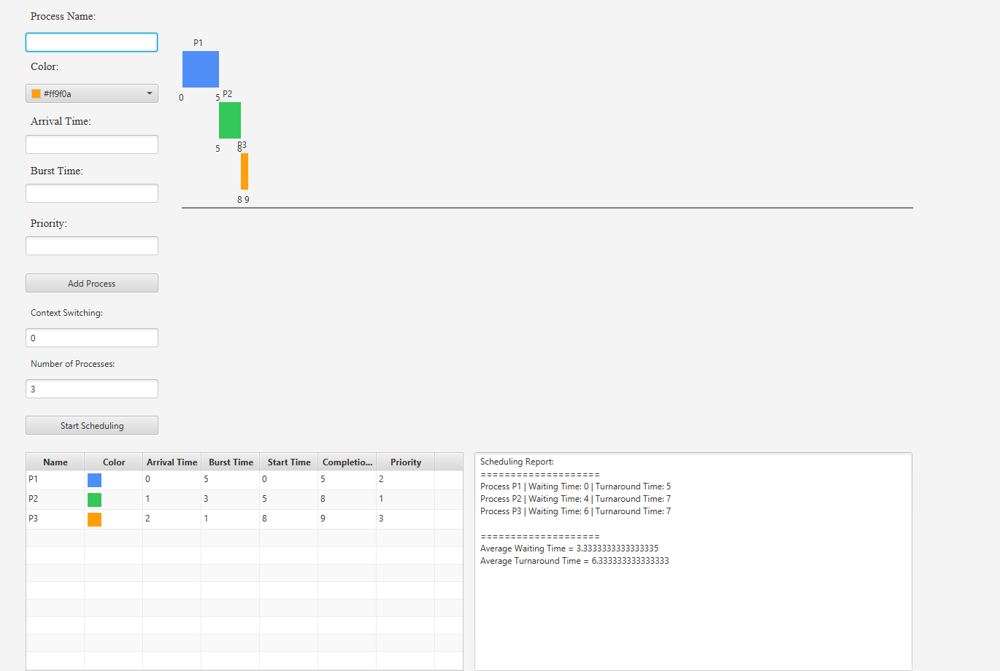

# Priority CPU Scheduler (JavaFX)

A desktop simulator for **non-preemptive Priority CPU scheduling**, built with JavaFX and Maven.
Enter processes (name, color, arrival time, burst time, priority), set a context-switch cost, and
the app computes start/completion times, waiting and turnaround averages, shows them in a table,
and draws a timeline of the schedule.



## Features

- Add any number of processes, each with its own color, arrival time, burst time and priority
- Non-preemptive priority scheduling (a **lower priority number runs first**)
- Configurable context-switch overhead per dispatch
- Results table: start time, completion time, priority per process
- Report with waiting time / turnaround time for every process and the averages
- Timeline (Gantt-style) view of the schedule
- Input errors are reported in the UI instead of crashing the app

## Tech stack

| | |
|---|---|
| Language | Java 23 |
| UI | JavaFX 17.0.6 + FXML |
| Build | Maven (with Maven Wrapper) |
| Tests | JUnit 5 (dependency configured) |

## Getting started

**Requirements:** JDK 23 and an internet connection for the first build (Maven downloads JavaFX).
You do **not** need to install the JavaFX SDK manually.

```bash
# macOS / Linux
./mvnw clean javafx:run

# Windows
mvnw.cmd clean javafx:run
```

Or open the project in IntelliJ IDEA, let Maven import finish, and run `HelloApplication`.

### How to use it

1. Fill in the process name, pick a color, and enter arrival time, burst time and priority.
2. Press **Add Process** (repeat for every process).
3. Enter the number of processes and the context-switch time.
4. Press **Start Scheduling** — the table, the report and the timeline update.

## How the algorithm works

1. Processes are sorted by arrival time.
2. At each step, every process that has arrived and is not finished becomes *ready*.
3. Ready processes are sorted by priority, and the one with the **smallest priority value**
   runs to completion (no preemption).
4. A context-switch cost is added between dispatches.
5. The loop repeats until all requested processes are completed.

```
waiting time    = start time      - arrival time
turnaround time = completion time - arrival time
```

## Project structure

```
.
├── pom.xml
├── mvnw / mvnw.cmd / .mvn/        # Maven Wrapper
├── docs/screenshot.png
└── src/
    ├── module-info.java
    └── main/
        ├── java/org/os/assignment_3/
        │   ├── HelloApplication.java    # JavaFX entry point
        │   ├── HelloController.java     # UI wiring, validation, Gantt drawing
        │   ├── PriorityScheduling.java  # Scheduling algorithm + report
        │   └── Process.java             # Process model
        └── resources/org/os/assignment_3/
            └── hello-view.fxml          # UI layout
```

## Known limitations

- **Non-preemptive only** — a running process cannot be interrupted.
- If *Number of Processes* is greater than the number of added processes, the scheduling loop
  never terminates. A guard is planned.
- Context-switch time is currently added during idle gaps as well, which can delay a process by
  one time unit.
- The timeline is drawn as one row per process rather than a single continuous Gantt bar.
- Negative values are not fully validated.
- Priorities are not aged, so low-priority processes can starve.

## Possible next steps

- Fix the edge cases above and add unit tests for the scheduler
- Draw a true continuous Gantt chart including idle and context-switch blocks
- Add save/load for process sets
- Trim the unused JavaFX dependencies from `pom.xml`

---

Built as an Operating Systems course assignment.
